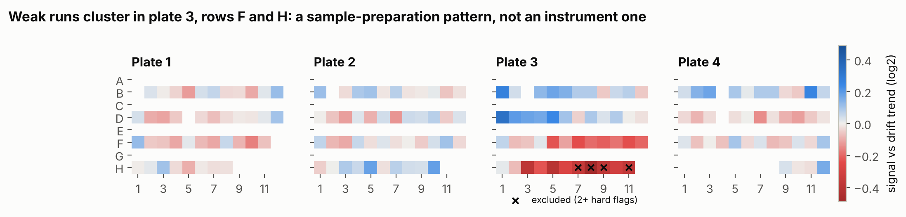

# DIA proteomics analysis pipeline in Python

A step-by-step, reproducible analysis of public data-independent acquisition (DIA) proteomics data: from a DIA-NN report through quality control, normalization and statistical testing. Every analytical decision is stated, justified, and checked against something known to be true.

**Author:** Alex Cioffi, Ph.D. · [cioffiscientific.com](https://cioffiscientific.com)

## Notebooks

| # | Notebook | Data | Status |
|---|---|---|---|
| 01 | [Import and quality control](notebooks/01_import_and_qc.ipynb) | Plasma/serum SWATH, DIA-NN (PXD018874) | ✅ |
| 02 | Normalization, drift correction and imputation | same | planned |
| 03 | Differential abundance calibrated against known truth | LFQ benchmark (PXD028735) | planned |

## Notebook 01 in one figure



Once each run's signal is corrected for instrument drift, the weak runs cluster in two rows of one plate. They were injected at random points across the 428-injection sequence, so the cause is sample preparation, not the instrument. Notebook 01 finds this with fixed QC rules that were set before looking at the data.

**Other Notebook 01 findings**
- **Technical replicates.** The plasma and serum wells are technical replicates of one material each, so all within-matrix variance is technical. Normalization in Notebook 02 can therefore be scored objectively.
- **Drift.** MS signal falls 41% across the sequence, which raises the raw CV from 7% (short-term) to 21%. That variance is what normalization has to remove.
- **Positive control.** Fibrinogen, which clotting removes from serum, comes out 16–300x higher in plasma than serum, while albumin is unchanged.
- **Inherited filters.** The protein-group FDR filter inherited from the report is replaced by a documented rule that approximates a global FDR. Its cost is shown explicitly.

## Data

| Notebook | Source | Citation |
|---|---|---|
| 01–02 | PRIDE [PXD018874](https://www.ebi.ac.uk/pride/archive/projects/PXD018874), platform-validation runs | Messner CB *et al.* *Cell Systems* 2020;11:11–24.e4. [doi:10.1016/j.cels.2020.05.012](https://doi.org/10.1016/j.cels.2020.05.012) |
| 03 | PRIDE [PXD028735](https://www.ebi.ac.uk/pride/archive/projects/PXD028735) | Van Puyvelde B *et al.* *Sci Data* 2022;9:126 |

Data files are not stored in this repository. See [`data/README.md`](data/README.md) for what to download and where to put it.

## Reproduce

Tested on Python 3.12 and 3.13, on Windows and Linux. Use a dedicated environment: installing into a base Anaconda environment can mix NumPy 1.x and 2.x builds.

**With conda (recommended on Windows; run in Anaconda Prompt):**
```bash
git clone https://github.com/acioffi3-spec/dia-proteomics-pipeline.git
cd dia-proteomics-pipeline
conda create -n dia-proteomics python=3.12 -y
conda activate dia-proteomics
python -m pip install -r requirements.txt
python -m ipykernel install --user --name dia-proteomics --display-name "Python (dia-proteomics)"
jupyter lab
```

**With venv (macOS / Linux):**
```bash
git clone https://github.com/acioffi3-spec/dia-proteomics-pipeline.git
cd dia-proteomics-pipeline
python3 -m venv .venv && source .venv/bin/activate
python -m pip install -r requirements.txt
jupyter lab
```

Then:
1. Put the data file in `data/raw/` as described in [`data/README.md`](data/README.md).
2. Open `notebooks/01_import_and_qc.ipynb` and select the project kernel.
3. Run all cells.

Notebook 01 runs in about a minute on a laptop with 8 GB RAM. The first run also writes a parquet cache to `data/processed/`.

**Two Windows pitfalls:**
- **Keep the project outside `Documents` and OneDrive.** Controlled Folder Access or sync software can stop Jupyter writing its checkpoint folder.
- **Turn on File Explorer → View → Show → File name extensions before renaming the data file.** Otherwise a hidden second extension (`.tsv.tsv`) can creep in.

## Repository layout

```
data/
  raw/          downloaded files (git-ignored)
  processed/    outputs passed between notebooks (git-ignored)
notebooks/      numbered analysis notebooks, run in order
src/            reusable functions, documented and imported by the notebooks
  diann_io.py   read DIA-NN reports
  metadata.py   build the sample table from run names
  qc.py         QC metrics (depth, missingness, CV, drift, RT, PCA, robust z)
  plotting.py   shared figure style and colour palette
figures/        exported figures (PNG)
```

## Conventions

- **Quantities.** Quantities stay on the linear scale until a function says otherwise. Every log transform is explicit (`np.log2`).
- **Outlier rules.** Robust statistics (median and MAD) are used for outlier rules, so that outliers cannot hide by inflating the SD.
- **QC thresholds.** QC thresholds are set before results are inspected and are applied as written. Patterns found afterwards are carried forward as hypotheses, not used to move thresholds.
- **Colours.** Each sample type keeps one fixed colour in every figure (plasma blue, serum orange, pooled QC green). The palette was checked for colour-vision deficiency.
