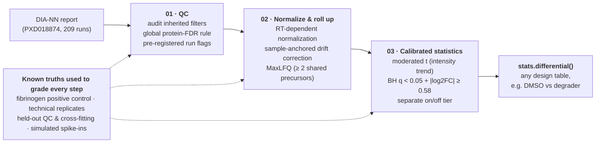
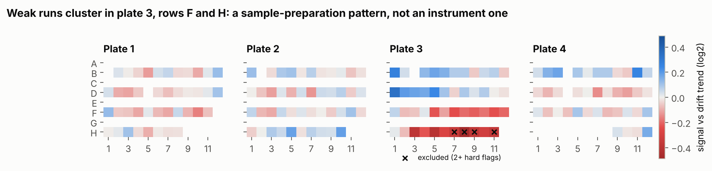
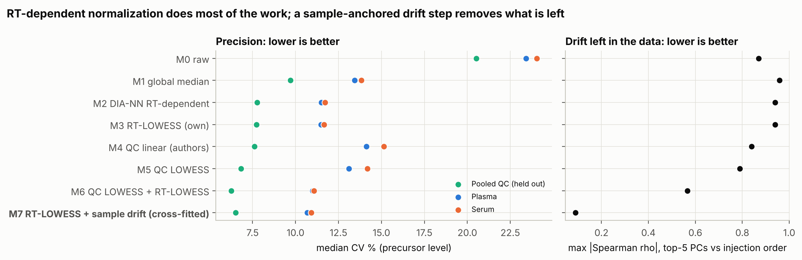
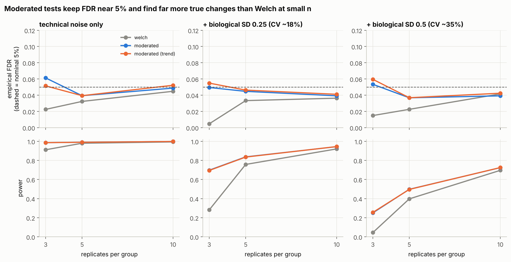

# DIA proteomics analysis pipeline in Python

[](https://github.com/acioffi3-spec/dia-proteomics-pipeline/actions/workflows/tests.yml)

A step-by-step, reproducible analysis of public data-independent acquisition (DIA) proteomics data: from a DIA-NN report through quality control, normalization and statistical testing. Every analytical decision is stated, justified, and checked against something known to be true.

**Author:** Alex Cioffi, Ph.D. · [cioffiscientific.com](https://cioffiscientific.com)

## Notebooks

| # | Notebook | Data | Status |
|---|---|---|---|
| 01 | [Import and quality control](notebooks/01_import_and_qc.ipynb) | Plasma/serum SWATH, DIA-NN (PXD018874) | ✅ |
| 02 | [Normalization, drift correction and protein roll-up](notebooks/02_normalization_and_rollup.ipynb) | same | ✅ |
| 03 | [Differential abundance calibrated against a known truth](notebooks/03_differential_abundance_calibration.ipynb) | same, with simulated known changes | ✅ |

## Pipeline at a glance



## Decision log

Each row is a question the analysis had to answer, the evidence used, and the decision taken. Decisions are justified from the data, not copied from the original authors; where they agree or disagree, the notebook shows why.

| # | Question | Evidence | Decision | Where |
|---|---|---|---|---|
| 1 | What filtering did the report already have? | Maximum q-value per column; confirmed by the authors' methods | Tighten filters, never loosen them | [NB01](notebooks/01_import_and_qc.ipynb) §2 |
| 2 | Is the last number in each run name the injection order? | Unique per run; pooled QC every 10–11; smooth signal decline across it | Used as injection order, with the evidence shown | NB01 §3 |
| 3 | Can peak width be used for QC? | `RT.Stop − RT.Start` is a constant 4.44 s window, not a measurement | Dropped: a metric that cannot vary cannot warn | NB01 §4 |
| 4 | Protein-group FDR: 1% per run? | Per-run q-values resolve only ~1/180; a strict per-run rule empties 42 of 209 runs; the "best run" rule is a multiple-testing trap | Keep a protein group if q ≤ 1% in ≥ 25% of runs of one matrix; checked against two alternatives | NB01 §5, [NB02](notebooks/02_normalization_and_rollup.ipynb) §8 |
| 5 | Which runs to exclude? | Thresholds fixed before looking; exclude only with ≥ 2 hard flags | 4 runs excluded; a plate-3 pattern found afterwards is flagged, not used to move thresholds | NB01 §13, NB02 §5 |
| 6 | Is drift the same for every peptide, and linear? | Drift rate depends on retention time (ρ = −0.74), reproducible (split-half r = 0.93), with a step at injection ~200 | Global scaling is insufficient, and a straight-line correction is the wrong shape | NB01 §9b |
| 7 | Correct drift against the pooled QC? | The QC drifts ~1.2× faster than the samples; 18% of peptides have no QC anchor | QC used for monitoring, not correction | NB02 §4 |
| 8 | Which normalization? | Eight methods on one scorecard, always scored on runs they were not fitted on | RT-dependent normalization + sample-anchored drift correction (valid only with randomized run order) | NB02 §3–5 |
| 9 | Which protein roll-up? | Synthetic data with known levels; a real case where single-peptide ratios turn "absent" into "equal" | MaxLFQ requiring ≥ 2 shared precursors | NB02 §6 |
| 10 | Which statistical test? | Null calibration and spike-ins: FDR and power at n = 3, 5, 10 and three noise levels | Moderated t with an intensity-dependent prior (2.5× the power of Welch at 3 vs 3) | [NB03](notebooks/03_differential_abundance_calibration.ipynb) §3–4 |
| 11 | Is our moderated t correct? | Compared with limma (the reference implementation) on a fixed dataset: plain version agreed to ~1e-10; the trend version did not (LOWESS vs limma's spline, t off by up to 3) | Switched the trend to a natural cubic spline; now matches to ~1e-10, checked on every push | NB03 §1, `tests/test_limma_crosscheck.py` |
| 12 | Does the calibration survive a small study normalizing only its own runs? | Each simulated experiment re-normalized from raw data: null still honest, but with many unbalanced changes FDR reaches 34–42% in precise data. Dropout hypothesis tested and rejected; offset tracks the imbalance of true changes | Treat §3–4 as a best case (realistic FDR 5–10%); make the effect-size filter standard | NB03 §4b |
| 13 | Is a fold-change cutoff enough? | Fold change alone: up to 33% false hits; unadjusted p: 16–26%; q < 0.05 plus \|log2FC\| ≥ 0.58 keeps FDR ≤ 4.2% in the stress test | BH q < 0.05 **plus** \|log2FC\| ≥ 0.58 | NB03 §4b, §5 |
| 14 | Impute missing values? | No gain for testing; KNN biases large changes; "absent from one group" is a true change only ~half the time | No imputation; on/off proteins in a separate, calibrated tier | NB03 §6 |
| 15 | How many replicates does a study need? | Power by effect size, replicates and noise | ~3 per group for 2-fold changes at CV ~18%; ~10 for 1.5-fold | NB03 §8 |

## Notebook 01 in one figure



Once each run's signal is corrected for instrument drift, the weak runs cluster in two rows of one plate. They were injected at random points across the 428-injection sequence, so the cause is sample preparation, not the instrument. Notebook 01 finds this with fixed QC rules that were set before looking at the data.

**Other Notebook 01 findings**
- **Technical replicates.** The plasma and serum wells are technical replicates of commercial pooled material, so nearly all within-matrix variance is technical (Notebook 03 finds a few donor-variable proteins, such as immunoglobulins, that vary more). Normalization in Notebook 02 can therefore be scored objectively.
- **Drift.** MS signal falls 41% across the sequence, which raises the raw CV from 7% (short-term) to 21%. That variance is what normalization has to remove.
- **Positive control.** Fibrinogen, which clotting removes from serum, comes out 16–300x higher in plasma than serum, while albumin is unchanged.
- **Inherited filters.** The protein-group FDR filter inherited from the report is replaced by a documented rule that approximates a global FDR. Its cost is shown explicitly.

## Notebook 02 in one figure



Eight normalization strategies, scored on the same scorecard and always on runs they were not fitted on.

**Key Notebook 02 findings**
- **Retention-time-dependent normalization does most of the work.** It halves sample CVs. Our implementation reproduces DIA-NN's method (r = 0.9998).
- **A precursor-specific drift component survives it.** A per-precursor drift correction anchored on the samples removes it, which is valid because run order was randomized. This is the only method that leaves no principal component tied to injection order.
- **The pooled QC drifts about 1.2× faster than the samples.** Correcting samples against the QC, as the authors did, over-corrects them. The QC is kept for monitoring, not correction.
- **The remaining sample CV (~11%) is ~6.5% injection noise plus ~9% sample-preparation noise.** The preparation part cannot be normalized away.
- **Protein roll-up uses our own MaxLFQ**, validated on synthetic data. Requiring ≥ 2 shared precursors stops it from reporting absent fibrinogen-γ in serum as "equal to plasma".

## Notebook 03 in one figure



Known changes are spiked into technical replicates, so every call can be graded as right or wrong.

**Key Notebook 03 findings**
- **Which test:** a moderated t-test (empirical Bayes with an intensity-dependent prior; written from the equations, validated on synthetic data, and matching limma to ~1e-10) keeps the false discovery rate near 5%. At 3 vs 3 with realistic noise, it finds 70% of true changes, versus 28% for Welch's t-test.
- **Stress test, and a correction to my own calibration:** when each small experiment normalizes only its own runs and many proteins change unevenly, the normalization shifts every protein by ~0.03 log2, and FDR climbs to 34–42% in precise data. The cause is the imbalance of the true changes, not missing values (tested and rejected). Adding |log2FC| ≥ 0.58 restores FDR to ≤ 4.2%, so it is now part of the recommended analysis.
- **Shortcuts are unsafe:** a fold-change cutoff alone lets up to 33% false hits through, and unadjusted p < 0.05 lets 16–26% through.
- **No imputation for testing:** KNN imputation biases large changes. Proteins absent from one group (on/off) are truly changed only about half the time, so they get their own calibrated tier (about 5% false calls).
- **Design guidance:** with replicate CVs around 18%, 3 replicates find about 80% of 2-fold changes but only a third of 1.5-fold changes.
- **Reusable:** `stats.differential(proteins, design, "DMSO", "compound")` runs the whole calibrated analysis on any dataset from a design table.

## Data

| Notebook | Source | Citation |
|---|---|---|
| 01–02 | PRIDE [PXD018874](https://www.ebi.ac.uk/pride/archive/projects/PXD018874), platform-validation runs | Messner CB *et al.* *Cell Systems* 2020;11:11–24.e4. [doi:10.1016/j.cels.2020.05.012](https://doi.org/10.1016/j.cels.2020.05.012) |
| 03 | Notebook 02 outputs (PXD018874), with simulated known changes | (no additional download) |

Data files are not stored in this repository. See [`data/README.md`](data/README.md) for what to download and where to put it.

## Reproduce

Tested on Python 3.12 and 3.13, on Windows and Linux. Use a dedicated environment: installing into a base Anaconda environment can mix NumPy 1.x and 2.x builds.

**With conda (recommended on Windows; run in Anaconda Prompt):**
```bash
git clone https://github.com/acioffi3-spec/dia-proteomics-pipeline.git
cd dia-proteomics-pipeline
conda create -n dia-proteomics python=3.12 -y
conda activate dia-proteomics
python -m pip install -r requirements.txt
python -m ipykernel install --user --name dia-proteomics --display-name "Python (dia-proteomics)"
jupyter lab
```

**With venv (macOS / Linux):**
```bash
git clone https://github.com/acioffi3-spec/dia-proteomics-pipeline.git
cd dia-proteomics-pipeline
python3 -m venv .venv && source .venv/bin/activate
python -m pip install -r requirements.txt
jupyter lab
```

Then:
1. Put the data file in `data/raw/` as described in [`data/README.md`](data/README.md).
2. Open the notebooks in order (`01_...`, then `02_...`) and select the project kernel. Each notebook reads the previous one's outputs from `data/processed/`.
3. Run all cells.

On a laptop with 8 GB RAM, Notebook 01 runs in about a minute, Notebook 02 in about 8 minutes (cross-fitting refits every drift curve several times) and Notebook 03 in about 20 minutes the first time (simulations; cached afterwards, set `RERUN = True` to regenerate). The first run also writes a parquet cache to `data/processed/`.

**Two Windows pitfalls:**
- **Keep the project outside `Documents` and OneDrive.** Controlled Folder Access or sync software can stop Jupyter writing its checkpoint folder.
- **Keep the data file name exactly as PRIDE provides it** (`data.diannoutput.qc.tsv`). If you ever rename files, turn on File Explorer → View → Show → File name extensions first, so a hidden second extension (`.tsv.tsv`) cannot creep in.

## Tests

The functions in `src/` are covered by an automated test suite (`tests/`, 48 tests, about 5 seconds), run by GitHub Actions on Python 3.12 and 3.13 on every push. Most tests check a property the notebooks rely on, using synthetic data with a known answer. For example:
- the moderated t-test reproduces limma's output (frozen reference values in `tests/data/`, plus a live comparison when the `inmoose` port of limma is installed)
- the moderated t-test recovers a known variance prior and gives uniform p-values when nothing changes
- the intensity-trend prior removes false positives among noisy low-abundance proteins
- MaxLFQ recovers true protein levels despite 30% missing values, and refuses a ratio built on a single shared peptide
- sample-anchored drift correction removes drift without removing a real group difference
- cross-fitting never lets a run help correct itself
- simulated spike-ins only remove values that went down, and FDR/power scoring counts wrong-direction calls as false
- simulated experiments are normalized using only their own runs, and bootstrap intervals bracket the FDR estimate

```bash
python -m pip install -r requirements-dev.txt
python -m pytest            # tests
python -m ruff check src tests   # code style
```

## Known limitations

- **No access to the raw search.** The spectral library, protein inference and DIA-NN version (1.7.10) are inherited. With raw-data access, a re-search in DIA-NN ≥ 1.8 would provide a proper global protein q-value in place of the rule in decision 4.
- **The statistical calibration is semi-synthetic.** Spike-ins into technical replicates cannot reproduce ratio compression from interfering peptides in real mixtures. A validation on a real hybrid-proteome benchmark is planned (Notebook 04).
- **The plasma wells are not perfectly identical.** A few donor-variable proteins vary 5–14× more between wells than in the pooled QC. Random splits keep the tests valid, but false calls among co-varying proteins come in bursts, so FDR estimates carry bootstrap intervals.
- **One dataset so far.** The normalization assumptions (most peptides unchanged in each run; randomized run order) are checked here and must be re-checked for every new design.

## Repository layout

```
data/
  raw/          downloaded files (git-ignored)
  processed/    outputs passed between notebooks (git-ignored)
notebooks/      numbered analysis notebooks, run in order
src/            reusable functions, documented and imported by the notebooks
  diann_io.py   read DIA-NN reports
  metadata.py   build the sample table from run names
  qc.py         QC metrics (depth, missingness, CV, drift, RT, PCA, robust z)
  normalize.py  median, RT-dependent, QC-anchored and sample-anchored corrections; cross-fitting
  rollup.py     protein roll-up: top-N, median polish, MaxLFQ
  evaluate.py   the shared scorecard used to compare normalizations
  stats.py      Welch and moderated t (empirical Bayes, optional intensity trend), BH; stats.differential()
  impute.py     imputation strategies (down-shifted normal, run minimum, KNN)
  simulate.py   null splits, biological noise, precursor-level spike-ins with detection loss
  benchmark.py  run simulation grids and score empirical FDR, power and fold-change accuracy
  plotting.py   shared figure style and colour palette
tests/          automated tests for src/ (pytest), run on every push
  data/         frozen limma reference values and the script that regenerates them
figures/        exported figures (PNG)
.github/        continuous-integration workflow (tests + code style)
```

## Conventions

- **Quantities.** Quantities stay on the linear scale until a function says otherwise. Every log transform is explicit (`np.log2`).
- **Outlier rules.** Robust statistics (median and MAD) are used for outlier rules, so that outliers cannot hide by inflating the SD.
- **QC thresholds.** QC thresholds are set before results are inspected and are applied as written. Patterns found afterwards are carried forward as hypotheses, not used to move thresholds.
- **Honest scoring.** Any method fitted on some runs is scored on runs it never saw (held-out QC injections, or cross-fitting).
- **Validate, then use.** Every statistical method is checked on synthetic data with a known answer before it is applied to real data.
- **Colours.** Each sample type keeps one fixed colour in every figure (plasma blue, serum orange, pooled QC green). The palette was checked for colour-vision deficiency.
